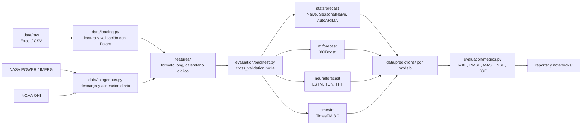
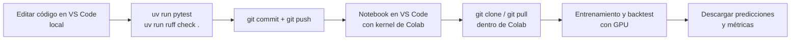

# Orinoco Forecast

Pronóstico del nivel diario del río Orinoco con **14 días de anticipación**, desarrollado
para la materia *Inteligencia Artificial: Aprendizaje Automático* (UCAB). El proyecto
evalúa seis familias de modelos bajo un mismo protocolo de evaluación cronológica y
**selecciona uno como modelo final**, respondiendo una pregunta concreta: **¿qué modelo
predice mejor el comportamiento del río a dos semanas, y cuánto mejora respecto a una
predicción ingenua?**

> **Estado:** en construcción. La sección [Estado de implementación](#estado-de-implementación)
> indica qué partes ya funcionan y cuáles están pendientes.

---

## Tabla de contenidos

1. [Problema y objetivos](#problema-y-objetivos)
2. [Datos](#datos)
3. [Arquitectura del pipeline](#arquitectura-del-pipeline)
4. [Modelos](#modelos)
5. [Protocolo de evaluación](#protocolo-de-evaluación)
6. [Prevención de fuga de datos](#prevención-de-fuga-de-datos)
7. [Estructura del repositorio](#estructura-del-repositorio)
8. [Configuración](#configuración)
9. [Entorno de desarrollo](#entorno-de-desarrollo)
10. [Flujo de trabajo: local + Google Colab](#flujo-de-trabajo-local--google-colab)
11. [Convenciones](#convenciones)
12. [Estado de implementación](#estado-de-implementación)
13. [Licencias](#licencias)
14. [Bibliografía](#bibliografía)

---

## Problema y objetivos

Se busca predecir, a partir de la información disponible hasta un día `t`, el nivel del río
en cada uno de los días `t+1, t+2, …, t+14`. Este tipo de problema se llama
**pronóstico multi-paso** (*multi-step forecasting*): el modelo no entrega un único valor,
sino una trayectoria de 14 valores.

**Variables objetivo (*targets*):**

| Target | Estación | Motivo |
|---|---|---|
| `ciudad_bolivar` | Ciudad Bolívar | Estación de referencia, con el registro histórico más largo (1930–2025). |
| `palua` | Palúa | Estación aguas abajo; permite evaluar si los modelos generalizan a un punto del río con dinámica distinta. |

**Variables predictoras:** niveles rezagados de las estaciones aguas arriba (Ayacucho,
Caicara y, para Palúa, Ciudad Bolívar), variables cíclicas de calendario, precipitación
(NASA) y el estado del fenómeno El Niño / La Niña (índice ONI de NOAA).

**Objetivos del proyecto:**

- Construir y evaluar seis familias de modelos: ARIMA, ensamble de árboles, LSTM, red
  convolucional, Transformer y el modelo fundacional de Google (TimesFM).
- Evaluarlos con un protocolo idéntico y libre de fuga de datos.
- Medir cada modelo contra modelos de referencia simples (*baselines*).
- **Seleccionar un único modelo final** con un criterio definido antes de ver los
  resultados, y medir su desempeño una sola vez en un período de test reservado.
- Cuantificar cuánto aportan las variables exógenas (lluvia, ENSO) frente a usar solo la
  historia del río.

---

## Datos

### Fuentes del río (en `data/raw/`)

| Archivo | Contenido | Rango | Uso en el proyecto |
|---|---|---|---|
| `Niveles Orinoco.xlsx` | Niveles diarios de 4 estaciones: `ayacucho`, `caicara`, `ciudad_bolivar`, `palua`. | 1974-01-01 a 2025-02-24 (18 683 días) | **Fuente principal.** Es la única con las cuatro estaciones alineadas día a día. |
| `Niveles Del Orinoco Est. Ciudad Bolivar 1930-2025.xlsx` | Histórico de Ciudad Bolívar con años en columnas y días en filas (sin 29 de febrero). | 1930 a 2025 | Extiende Ciudad Bolívar hasta 2025-12-31 y sirve para detectar valores imputados en la fuente principal. |
| `Nivel Orinoco Formateado.csv` | La fuente principal extendida a mano hasta 2025-12-31 con lecturas del histórico. | 1974-01-01 a 2025-12-31 | No se usa: el pipeline la reproduce con código a partir de las dos fuentes anteriores. |
| `dataset_imputado_simpleml.csv.xls` | CSV (pese a la extensión) idéntico, celda por celda, a `Niveles Orinoco.xlsx`. | 1974 a 2025 | No se usa: es un duplicado. |

La descripción detallada de cada archivo (columnas, nulos, rarezas) está en
[`data/raw/README.md`](data/raw/README.md). Las estaciones están ordenadas de aguas arriba
a aguas abajo: **Ayacucho → Caicara → Ciudad Bolívar → Palúa**. Ese orden importa: una
subida de nivel en Ayacucho llega días después a Ciudad Bolívar, por lo que los niveles
rezagados de las estaciones superiores son predictores naturales.

### Calidad de los datos

La auditoría de las fuentes encontró lo siguiente:

| Hallazgo | Detalle |
|---|---|
| Nulos en la fuente principal | Ayacucho, Caicara y Ciudad Bolívar: ninguno. Palúa: 17, casi todos el 29 de febrero de años bisiestos (1976–1996); el hueco más largo es de 3 días. |
| Fuente principal ya procesada | `Niveles Orinoco.xlsx` es idéntico a `dataset_imputado_simpleml`. Donde el histórico de Ciudad Bolívar tiene nulos (por ejemplo en 2021), la fuente principal tiene valores con forma de interpolación. No es posible distinguir valores observados de imputados en Ayacucho, Caicara y Palúa. |
| Conflicto entre fuentes de Ciudad Bolívar | Coinciden casi exactamente en 1984–1986 y 1998–2025. Difieren entre 5 y 12 cm en 1974–1982, y de forma importante en **1987** (mayo–diciembre, error medio de 0,83 m) y **1997** (error medio de 1,22 m, con aparente desfase de fechas). |
| Valores repetidos sospechosos | Ciudad Bolívar repite 2,78 m durante 19 días desde 2020-03-25; Palúa repite 1,8 m durante 16 días desde 1996-04-08. Un río no se queda inmóvil tantos días: son nulos disfrazados. |
| Hueco largo en el histórico | 161 días sin datos entre 1933-10-11 y 1934-03-20. |

**Limitación declarada:** los datos de base ya traían una imputación de origen
desconocido. Los resultados del proyecto deben leerse con esa salvedad.

#### Tratamiento

Ningún valor de `data/raw/` se modifica. Al extraer los datos a `data/interim/`, cada valor
recibe una etiqueta en la columna `quality`:

| Etiqueta | Significado |
|---|---|
| `observed` | Valor tal como viene de la fuente. |
| `missing` | Sin valor. |
| `suspect_flat` | Forma parte de una racha de 10 o más días con el mismo valor exacto. |
| `suspect_jump` | Cambio diario anormalmente grande respecto a los días vecinos. |
| `source_conflict` | Las dos fuentes de Ciudad Bolívar difieren de forma importante (1987, 1997). |

Las etiquetas hacen explícita cada decisión y permiten revertirla cambiando una regla, en
lugar de corregir los archivos a mano. Los huecos se tratan según su tipo:

| Tipo de hueco | Tratamiento | Motivo |
|---|---|---|
| 1 a 3 días | Interpolación lineal en el tiempo | El río cambia pocos centímetros por día; el error es despreciable. |
| Racha `suspect_flat` | Se convierte en nulo y se trata como hueco de esa longitud | Dejarla enseñaría al modelo que el río puede quedarse inmóvil. |
| Hueco largo (meses) | No se rellena; la serie se recorta | Interpolar meses es inventar una temporada completa. |
| Ciudad Bolívar sin estaciones vecinas (desde 2025-02-25) | No se imputan las estaciones vecinas | Ese tramo solo sirve a los modelos que usan únicamente Ciudad Bolívar. |

Se descartaron rellenar con la media (destruye la estacionalidad), repetir el último valor
(crea las mismas rachas planas que se buscan eliminar) e imputar con un modelo de ML (más
complejo y propenso a fuga de datos, sin ventaja para huecos de pocos días). La imputación
se aplica dentro de cada ventana de entrenamiento, nunca sobre la serie completa.

### Ubicación de las estaciones

Coordenadas aproximadas de cada localidad según Google Maps (no son las coordenadas
oficiales de las reglas limnimétricas). El Orinoco corre hacia el este en este tramo, así
que una longitud mayor (menos negativa) indica una posición más aguas abajo.

| Estación | Localidad en Google Maps | Latitud | Longitud |
|---|---|---|---|
| Ayacucho | Puerto Ayacucho, Amazonas | 5.66 | -67.62 |
| Caicara | Caicara del Orinoco, Bolívar | 7.61 | -66.15 |
| Ciudad Bolívar | Ciudad Bolívar, Bolívar | 8.09 | -63.56 |
| Palúa | Puerto de Palúa (Ferrominera), Ciudad Guayana | 8.32 | -62.75 |

Palúa queda unos 5 km aguas arriba de la confluencia con el río Caroní (8.35, -62.72),
cuyo caudal está regulado por las represas del Bajo Caroní. Por estar tan cerca, su nivel
podría verse afectado por el remanso (*backwater*) del Caroní; es una hipótesis a
contrastar con los datos, no un hecho verificado. Estas coordenadas sirven también para
consultar la precipitación puntual en NASA POWER.

### Fuentes exógenas

| Variable | Fuente | Cobertura | Uso |
|---|---|---|---|
| Precipitación diaria (`PRECTOTCORR`) | [NASA POWER, API diaria](https://power.larc.nasa.gov/docs/services/api/temporal/daily/) | Desde 1981-01-01 | Lluvia acumulada sobre la cuenca, rezagada. |
| Precipitación satelital | [NASA GPM IMERG V07](https://gpm.nasa.gov/data/imerg) | Desde junio de 2000 | Alternativa de mayor resolución espacial. |
| Índice ONI (El Niño / La Niña) | [NOAA CPC](https://www.cpc.ncep.noaa.gov/data/indices/oni.ascii.txt) | Desde 1950 | Estado climático de gran escala; mensual, se lleva a diario con *forward fill*. |

**Consecuencia de la cobertura:** los experimentos con lluvia solo pueden usar datos desde
1981 (NASA POWER) o desde 2000 (IMERG). Para que la comparación sea justa, los modelos sin
variables exógenas se evalúan también sobre esa misma ventana temporal.

---

## Arquitectura del pipeline

El proyecto es un pipeline lineal: los datos crudos se cargan y validan, se enriquecen con
variables predictoras, y un único motor de evaluación ejecuta todos los modelos sobre los
mismos cortes temporales. Las predicciones de todos los modelos terminan en una tabla con el
mismo formato, lo que permite calcular las métricas y los gráficos con un solo código.



### El formato común de datos (*long format*)

Todos los modelos reciben y devuelven tablas con el mismo esquema, el que usan las
librerías de [Nixtla](https://nixtlaverse.nixtla.io/):

| Columna | Significado |
|---|---|
| `unique_id` | Serie a la que pertenece la fila (`ciudad_bolivar` o `palua`). |
| `ds` | Fecha. |
| `y` | Nivel observado del río (target). |
| columnas extra | Variables predictoras (estaciones aguas arriba, lluvia, ONI, calendario). |

Ejemplo:

| unique_id | ds | y | ayacucho | caicara |
|---|---|---|---|---|
| ciudad_bolivar | 1974-01-01 | 6.89 | 43.34 | 24.98 |
| ciudad_bolivar | 1974-01-02 | 6.78 | 43.25 | 24.88 |
| palua | 1974-01-01 | 3.83 | 43.34 | 24.98 |

Los dos targets conviven en la misma tabla y se distinguen por `unique_id`. Esto permite
entrenar **modelos globales**: un solo modelo que aprende de ambas series a la vez.

La salida de la validación cruzada de cada modelo tiene la forma
`unique_id, ds, cutoff, y, <predicción>`, donde `cutoff` es el último día de información
que el modelo tenía disponible al predecir.

### Por qué Nixtla

Las tres librerías de Nixtla (`statsforecast`, `mlforecast`, `neuralforecast`) comparten el
formato de datos anterior y el mismo método `cross_validation`. Eso garantiza que los seis
modelos se evalúen exactamente sobre los mismos cortes y con la misma lógica, sin tener que
programar el ventaneo, el entrenamiento ni el backtesting por separado para cada familia.
TimesFM no forma parte de Nixtla; se usa con su librería oficial y un adaptador convierte
su salida al mismo formato.

### Rol de Polars

[Polars](https://pola.rs/) se usa para la carga, limpieza y transformación de datos
(`data/` y `features/`). `statsforecast` y `mlforecast` aceptan DataFrames de Polars
directamente; `neuralforecast` documenta entrada en pandas, por lo que en ese punto se
convierte con `.to_pandas()`.

---

## Modelos

Se selecciona **un único modelo final para ambas estaciones**. Los hiperparámetros, su
justificación y las fuentes de datos externas de cada modelo están detallados en
[`docs/plan_modelos.md`](docs/plan_modelos.md).

| Familia | Modelo | Librería | Notas |
|---|---|---|---|
| Baseline | `Naive` (persistencia) | statsforecast | Predice que el nivel se mantiene igual al último observado. |
| Baseline | `SeasonalNaive` | statsforecast | Predice el valor del mismo día del año anterior (`season_length=365`). |
| Series temporales | `AutoARIMA` | statsforecast | Selecciona automáticamente el orden (p, d, q) del modelo ARIMA. |
| Ensamble de árboles | `XGBRegressor` | mlforecast + xgboost | Gradient boosting sobre lags y variables de calendario. |
| Recurrente | `LSTM` | neuralforecast | Acepta covariables históricas (`hist_exog_list`). |
| Convolucional | `TCN` | neuralforecast | Red de convoluciones causales; acepta covariables históricas. |
| Transformer | `TFT` | neuralforecast | Temporal Fusion Transformer; acepta covariables históricas, futuras y estáticas. |
| Fundacional (Google) | `TimesFM 3.0` | timesfm | Modelo preentrenado usado *zero-shot* (sin reentrenamiento); acepta covariables. |

**Por qué los baselines son obligatorios:** el Orinoco es un río de gran caudal que cambia
lentamente, así que la persistencia a 14 días es un competidor difícil de superar. Un
modelo complejo solo aporta valor si les gana a los baselines; sin ellos, ninguna métrica
es interpretable.

**Por qué TFT como Transformer:** de los Transformers de `neuralforecast`, TFT es el que
admite covariables históricas, igual que el LSTM y el TCN. Esto mantiene la comparación
entre redes en igualdad de condiciones. La tabla de capacidades por modelo está en la
[documentación de neuralforecast](https://nixtlaverse.nixtla.io/neuralforecast/docs/capabilities/overview.html).

---

## Protocolo de evaluación

### División temporal: validación y test final

El objetivo es elegir un modelo, y elegir con los mismos datos con que se reporta el
resultado produce **sesgo de selección** (*selection bias*): el modelo ganador parece mejor
de lo que es, porque parte de su ventaja es haber encajado por azar con esos datos. Por eso
el tiempo se divide en bloques con funciones distintas:

```text
|------------ entrenamiento ------------|--- validación ---|--- test final ---|
 1974                                                    test_start      2025-02-24
```

| Bloque | Para qué se usa | Qué modelos lo ven |
|---|---|---|
| Entrenamiento | Ajustar los modelos. | Los seis modelos y los baselines. |
| Validación | Ventanas de backtest para comparar modelos, ajustar hiperparámetros y **elegir el modelo final**. | Los seis modelos y los baselines. |
| Test final | Medir **una sola vez** el desempeño del modelo ya elegido. | Solo el modelo seleccionado y los baselines como referencia. |

El test final no se consulta hasta que la elección está cerrada. Si después de verlo se
cambia el modelo, el test deja de medir el desempeño real y el resultado reportado vuelve a
estar sesgado.

### Validación cruzada con origen móvil (*rolling origin*)

Las series temporales no se pueden dividir al azar: un *k-fold* aleatorio entrenaría con el
futuro y evaluaría con el pasado. Dentro del bloque de validación se usa **origen móvil con
ventana expandida**:

1. Se elige un punto de corte (`cutoff`) en el pasado.
2. El modelo se entrena solo con los datos anteriores al corte.
3. Predice los 14 días siguientes y se compara con lo observado.
4. El corte avanza `step_size` días y se repite el proceso `n_windows` veces.

```text
ventana 1:  [========== entrenamiento ==========][14 días test]
ventana 2:  [============= entrenamiento =============][14 días test]
ventana 3:  [================ entrenamiento ================][14 días test]
                                                    ... avanza 30 días cada vez
```

| Parámetro | Valor | Significado |
|---|---|---|
| `horizon` (`h`) | 14 | Días que se pronostican desde cada corte. |
| `step_size` | 30 | Días que avanza el corte entre ventanas. |
| `n_windows` | 24 | Número de cortes evaluados (unos dos años de pronósticos), todos anteriores a `test_start`. |
| `test_start` | 2023-01-01 | Primer día del test final; desde aquí hasta 2025-02-24 queda reservado. |

Estos valores viven únicamente en `configs/backtest.yaml` y los comparten todos los
modelos.

### Métricas

| Métrica | Qué mide | Interpretación |
|---|---|---|
| MAE | Error absoluto medio, en metros. | Más bajo es mejor. |
| RMSE | Raíz del error cuadrático medio, en metros. | Penaliza más los errores grandes (crecidas mal predichas). |
| MASE | MAE escalado por el error de la persistencia en entrenamiento. | Menor que 1 significa que el modelo supera a la persistencia. |
| NSE | Eficiencia de Nash-Sutcliffe, estándar en hidrología. | 1 es perfecto; 0 equivale a predecir la media; negativo es peor que la media. |
| KGE | Eficiencia de Kling-Gupta: combina correlación, sesgo y variabilidad. | 1 es perfecto. |

Las métricas se reportan **por paso del horizonte** (`h = 1, …, 14`), por estación y en
promedio. El error a 1 día y el error a 14 días son problemas distintos, y promediarlos
esconde dónde falla cada modelo.

### Criterio de selección del modelo final

El criterio se fija antes de ver los resultados. Si se define después, siempre se encuentra
uno que favorezca al modelo preferido.

1. **Requisito mínimo:** el modelo debe superar a la persistencia (MASE < 1) en **cada
   estación por separado**, sobre el bloque de validación. El MASE no tiene unidades, así
   que este control impide que Ciudad Bolívar, con niveles mayores, domine la elección. Si
   ningún modelo lo cumple, ese es el resultado principal del proyecto.
2. **Métrica principal:** MAE promedio de `h = 1` a `14`, promediado entre Ciudad Bolívar y
   Palúa, sobre las ventanas de validación.
3. **Desempate**, si dos modelos quedan a pocos centímetros, en este orden:
   - menor error en los días 10 a 14, el tramo que realmente exige el problema;
   - menor error durante crecidas;
   - menor complejidad y costo de entrenamiento.

El modelo elegido se evalúa después una única vez en el test final, junto a los baselines.
Ese número es el que se reporta como desempeño esperado.

---

## Prevención de fuga de datos

La **fuga de datos** (*data leakage*) ocurre cuando el modelo usa, durante el entrenamiento
o la evaluación, información que no estaría disponible en el momento real de predecir.
Produce métricas excelentes en el informe y un modelo inútil en la práctica. Reglas del
proyecto:

1. **Covariables solo rezagadas.** El nivel de Ayacucho, Caicara o la lluvia del día
   `t+5` no se conoce en el día `t`. Estas variables se declaran como **históricas**
   (`hist_exog_list` en neuralforecast; lags en mlforecast), de modo que la librería solo
   usa sus valores hasta el corte.
2. **Solo las variables de calendario son futuras.** El día del año (codificado como seno y
   coseno) se conoce de antemano y es la única variable declarada como futura
   (`futr_exog_list`).
3. **Preprocesamiento ajustado solo en entrenamiento.** El escalado y la imputación de
   nulos se calculan dentro de cada ventana, usando únicamente sus datos de entrenamiento.
   Ningún dato se imputa usando valores posteriores al corte.
4. **ONI con retraso de publicación.** El índice ONI es un promedio móvil de tres meses que
   se publica después de que termina el período; se desplaza en el tiempo para usar solo
   valores que ya estaban publicados en cada fecha.
5. **Experimentos con "lluvia perfecta" etiquetados como tales.** Si se usa la lluvia
   observada de los días futuros, el resultado se reporta como cota superior teórica, no
   como desempeño real.
6. **La selección solo usa validación.** Elegir el modelo, sus hiperparámetros o sus
   variables mirando el test final es fuga de datos aplicada a la decisión.

---

## Estructura del repositorio

```text
Proyecto-IA-Orinoco/
├── configs/                     # Toda la configuración del proyecto
│   ├── data.yaml                # Fuentes de datos: rutas, columnas, formato
│   ├── backtest.yaml            # Protocolo compartido: horizon, ventanas, test_start
│   ├── ensemble.yaml            # Combinación de modelos (experimento opcional)
│   └── models/                  # Hiperparámetros por familia
│       ├── arima.yaml           # AutoARIMA
│       ├── tree.yaml            # XGBoost + lags
│       ├── lstm.yaml            # LSTM
│       ├── cnn.yaml             # TCN
│       ├── transformer.yaml     # TFT
│       └── timesfm.yaml         # TimesFM 3.0
├── data/
│   ├── raw/                     # Datos originales, inmutables (versionados)
│   ├── external/                # Descargas de NASA y NOAA (no versionadas)
│   ├── interim/                 # Datos intermedios (no versionados)
│   ├── processed/               # Tabla final en formato long (no versionada)
│   └── predictions/<modelo>/    # Salida de cross_validation por modelo
├── docs/                        # Plan de modelos y apoyo al informe
├── notebooks/                   # Exploración y presentación de resultados
├── reports/figures/             # Gráficos finales
├── scripts/                     # Puntos de entrada por línea de comandos
│   ├── run_model.py             # Ejecuta el backtest de un modelo configurado
│   ├── run_ensemble.py          # Combina predicciones (experimento opcional)
│   └── make_report.py           # Tablas comparativas, selección y test final
├── src/orinoco_forecast/        # Paquete Python del proyecto
│   ├── data/
│   │   ├── loading.py           # Lectura y validación de data/raw
│   │   └── exogenous.py         # Descarga de NASA POWER / IMERG y ONI
│   ├── features/
│   │   ├── lags.py              # Lags de estaciones aguas arriba
│   │   └── calendar.py          # Variables cíclicas (seno/coseno del día del año)
│   ├── models/
│   │   ├── statistical/         # Baselines y AutoARIMA (statsforecast)
│   │   ├── trees/               # XGBoost (mlforecast)
│   │   ├── neural/              # LSTM, TCN, TFT (neuralforecast)
│   │   ├── pretrained/          # Adaptador de TimesFM
│   │   └── registry.py          # Nombre de modelo -> objeto configurado
│   ├── evaluation/
│   │   ├── backtest.py          # Ejecuta cross_validation y guarda predicciones
│   │   └── metrics.py           # MAE, RMSE, MASE, NSE, KGE
│   ├── ensemble/                # Promedio y stacking (experimento opcional)
│   └── utils/                   # E/S, semillas, logging
├── tests/                       # Pruebas con pytest
├── pyproject.toml               # Dependencias y configuración de herramientas
├── uv.lock                      # Versiones exactas resueltas por uv
├── Makefile                     # Atajos: setup, test, lint, format, clean
└── AGENTS.md                    # Instrucciones para asistentes de IA
```

### Responsabilidad de cada capa

| Capa | Recibe | Devuelve | Regla clave |
|---|---|---|---|
| `data/` | Archivos de `data/raw/` y APIs externas | DataFrames de Polars validados | Nunca escribe en `data/raw/`; reporta anomalías con warnings en lugar de corregirlas en silencio. |
| `features/` | DataFrames validados | Tabla en formato long con predictoras | Ninguna feature usa información posterior a su fecha. |
| `models/` | Configuración YAML | Objetos de Nixtla / TimesFM listos para usar | No contiene lógica de evaluación. |
| `evaluation/` | Tabla long + modelos | Predicciones por corte y métricas | Es el único lugar que define cómo se parte el tiempo. |
| `notebooks/` | Funciones de `src/` | Análisis y gráficos | No contienen lógica reutilizable; la importan del paquete. |

---

## Configuración

Toda decisión experimental se declara en `configs/`, no en el código. Así un experimento se
reproduce leyendo sus YAML.

- **`configs/data.yaml`**: cada fuente declara `name`, `path`, `format`, `date_column`,
  `target_column`, `freq` y, si aplica, `sheet`, `covariates` o `layout`. Para agregar una
  fuente nueva se coloca el archivo original en `data/raw/` y se registra aquí.
- **`configs/backtest.yaml`**: única fuente de `horizon`, `step_size`, `n_windows` y `test_start`. Ningún
  modelo define su propio horizonte.
- **`configs/models/*.yaml`**: hiperparámetros de cada familia (por ejemplo `input_size`,
  `max_steps` y covariables para las redes; `lags` y parámetros de XGBoost para los
  árboles).

---

## Entorno de desarrollo

### Requisitos

- Python 3.12 (fijado en `.python-version`).
- [uv](https://docs.astral.sh/uv/) para gestionar el entorno y las dependencias.
- VS Code con las extensiones de Python, Jupyter y
  [Google Colab](https://developers.googleblog.com/google-colab-is-coming-to-vs-code/).

### Instalación local

```bash
uv sync
```

`uv sync` crea el entorno virtual `.venv/` con las versiones exactas de `uv.lock`.

### Comandos

| Comando | Atajo con Make | Qué hace |
|---|---|---|
| `uv sync` | `make setup` | Instala o actualiza el entorno. |
| `uv run pytest` | `make test` | Ejecuta las pruebas. |
| `uv run ruff check .` | `make lint` | Revisa estilo y errores comunes. |
| `uv run ruff format .` | `make format` | Formatea el código. |

En Windows `make` no viene instalado; se pueden usar los comandos `uv` directamente o
instalarlo con `choco install make` o `scoop install make`.

---

## Flujo de trabajo: local + Google Colab

El código se escribe y prueba en local con datos reducidos; el entrenamiento pesado (redes
neuronales y TimesFM) se ejecuta en Google Colab para aprovechar sus GPU.



### Dos cosas a tener en cuenta con la extensión de Colab

1. **El kernel corre en la máquina de Google, no en tu computadora.** Las rutas locales no
   existen en Colab, así que el código y los datos deben llegar al runtime clonando el
   repositorio (o montando Google Drive). Ver el
   [issue del repositorio oficial](https://github.com/googlecolab/colab-vscode/issues/210).
2. **En Colab no se usa `uv sync`.** `uv sync` crea un `.venv` que el kernel de Colab no
   utiliza, y además reinstalaría PyTorch, que Colab ya trae con soporte CUDA. En su lugar,
   el paquete se instala en el Python del sistema del runtime.

### Primera celda de un notebook en Colab

```python
!git clone https://github.com/Cesar2926/Proyecto-IA-Orinoco.git
%cd Proyecto-IA-Orinoco
!git checkout <rama-de-trabajo>
!pip install -q uv
!uv pip install --system -e .
```

Si el repositorio es privado, la clonación requiere autenticación con un token personal de
GitHub. Nunca escribas el token directamente en una celda que se vaya a versionar.

En sesiones posteriores basta con `!git pull` dentro de la carpeta del proyecto. Los
runtimes de Colab se reinician periódicamente: lo que no esté en el repositorio, en Google
Drive o descargado se pierde.

### Notebooks

Los notebooks se nombran con un número de orden, las iniciales del autor y una
descripción, por ejemplo `01-ac-exploracion-niveles.ipynb`. Importan las funciones del
paquete (`from orinoco_forecast.data.loading import load_source`) en lugar de copiar
código entre notebooks.

---

## Convenciones

- **`data/raw/` es inmutable.** Ningún código escribe ahí; los derivados van a
  `data/interim/` o `data/processed/`.
- **Idioma:** identificadores de código en inglés; docstrings, mensajes y documentación en
  español.
- **Commits** pequeños con prefijo [Conventional Commits](https://www.conventionalcommits.org/es/v1.0.0/):
  `feat:`, `fix:`, `docs:`, `chore:`, `test:`.
- **Ramas:** el trabajo se hace en ramas propias y se integra a `main` mediante pull
  request revisado por otro integrante.
- **Reproducibilidad:** semillas fijas para los modelos con aleatoriedad y versiones
  exactas en `uv.lock`.

---

## Estado de implementación

| Componente | Estado |
|---|---|
| Estructura de carpetas, configuración y entorno con uv | Disponible |
| Auditoría de datos crudos (`data/raw/README.md`) | Disponible |
| Carga y validación de datos (`data/loading.py`) | Pendiente |
| Alineación de NASA POWER y ONI (`data/exogenous.py`) | Disponible |
| Formato long y variables predictoras (`features/`) | Disponible (rezagos aguas arriba, lluvia, ONI y calendario) |
| Métricas MAE, RMSE, MASE, NSE, KGE | Pendiente |
| Baselines y AutoARIMA (statsforecast) | Pendiente |
| XGBoost (mlforecast) | Pendiente |
| LSTM, TCN, TFT (neuralforecast) | Pendiente |
| TimesFM 3.0 | Pendiente |
| Extracción a formato largo con columna `quality` | Pendiente |
| Comparación en validación y selección del modelo final | Pendiente |
| Evaluación del modelo elegido en el test final y reporte | Pendiente |
| Ensamble de modelos | Fuera del alcance; experimento opcional |

El orden de trabajo previsto es el de la tabla: primero datos, métricas y baselines, luego
los modelos de menor a mayor costo computacional, y al final las variables exógenas para
medir cuánto aportan.

### Construcción del dataset con variables externas

Los archivos externos ya descargados en `data/external/` se combinan con
`data/raw/Nivel Orinoco Formateado.csv` mediante:

```bash
uv run python scripts/build_exogenous_dataset.py
```

El resultado se escribe en `data/processed/orinoco_exogenous.parquet`. NASA POWER se
alinea por fecha como `rain_<estacion>` y el ONI se convierte de sus promedios móviles
trimestrales a una serie diaria mediante *forward fill*. Antes de esa expansión se aplica
el retraso de publicación configurado en `configs/data.yaml` (tres meses), para evitar
fuga de información. Los nulos de lluvia anteriores a 1981 se conservan y se reportan
como `DataQualityWarning`; no se imputan automáticamente.

Con `BUILD_RIVER_FEATURES = True` (variable de control al inicio de
`scripts/build_exogenous_dataset.py`), el script aplica además las features rezagadas
configuradas en `configs/data.yaml`:

| Columna | Contenido |
|---|---|
| `<estacion>_lag_<n>` | Nivel de la estación desplazado `n` días; ARIMAX solo usa los de estaciones aguas arriba. |
| `rain_<estacion>_lag_<n>` | Lluvia propia rezagada `n` días. |
| `oni_lag_<n>` | ONI rezagado `n` días. |
| `sin_doy`, `cos_doy` | Ciclo anual determinista (y armónicos opcionales). |

El orden aguas arriba se define una sola vez en `features.river_order`:
`ayacucho → caicara → ciudad_bolivar → palua`. Para el horizonte de 14 días, ARIMAX
selecciona solo rezagos `>= min_exog_lag` (14 por defecto), de modo que cada exógena
futura ya está observada en el corte. Los rezagos propios menores que el horizonte
quedan disponibles para otros modelos; en ARIMAX la inercia propia la aportan los
términos AR.

---

## Licencias

El checkpoint `google/timesfm-3.0-pytorch` se distribuye bajo la **TimesFM Non-Commercial
License v1.0**: los pesos solo pueden usarse con fines no comerciales y no productivos, lo
que es compatible con este proyecto académico. La licencia del código fuente de TimesFM no
sustituye a la de los pesos. Ver el
[README oficial](https://github.com/google-research/timesfm) y la
[tarjeta del modelo](https://huggingface.co/google/timesfm-3.0-pytorch).

---

## Bibliografía

### Libros

- Hyndman, R. J. y Athanasopoulos, G. *Forecasting: Principles and Practice*, 3.ª ed.
  [Edición en línea](https://otexts.com/fpp3/). Su edición en Python,
  *Forecasting: Principles and Practice, the Pythonic Way*, usa las librerías de Nixtla
  ([anuncio](https://forecasters.org/blog/2025/04/25/forecasting-principles-and-practice-the-pythonic-way)).
- Géron, A. *Hands-On Machine Learning with Scikit-Learn and PyTorch*. O'Reilly, 2025.
  [O'Reilly](https://oreilly.com/library/view/hands-on-machine-learning/9798341607972/).
- Huyen, C. *Designing Machine Learning Systems*. O'Reilly, 2022.
  [O'Reilly](https://oreilly.com/library/view/designing-machine-learning/9781098107956).
- Box, G., Jenkins, G., Reinsel, G. y Ljung, G. *Time Series Analysis: Forecasting and
  Control*, 5.ª ed. Wiley, 2015.

### Guías

- Zinkevich, M. [*Rules of Machine Learning*](https://developers.google.com/machine-learning/guides/rules-of-ml). Google.
- scikit-learn. [*Common pitfalls and recommended practices*](https://scikit-learn.org/stable/common_pitfalls.html) (fuga de datos en preprocesamiento).
- DrivenData. [*Cookiecutter Data Science*](https://cookiecutter-data-science.drivendata.org/opinions/) (organización de proyectos de ciencia de datos).

### Artículos

- Ben Taieb, S., Bontempi, G., Atiya, A. y Sorjamaa, A. (2012). A review and comparison of
  strategies for multi-step ahead time series forecasting. *Expert Systems with
  Applications*, 39(8). [Enlace](https://research.monash.edu/en/publications/a-review-and-comparison-of-strategies-for-multi-step-ahead-time-s/).
- Hyndman, R. J. y Koehler, A. B. (2006). Another look at measures of forecast accuracy
  (MASE). *International Journal of Forecasting*, 22(4).
  [DOI](https://www.doi.org/10.1016/J.IJFORECAST.2006.03.001).
- Nash, J. E. y Sutcliffe, J. V. (1970). River flow forecasting through conceptual models
  (NSE). *Journal of Hydrology*, 10(3). [Enlace](https://explore.openalex.org/works/w2033904036).
- Gupta, H. V. et al. (2009). Decomposition of the mean squared error and NSE performance
  criteria (KGE). *Journal of Hydrology*, 377.
  [PDF](https://ag.purdue.edu/hydrology/wiki/environmental-informatics/modeling-resources/attachments/gupta-et-al-2009.pdf).
- Hochreiter, S. y Schmidhuber, J. (1997). Long Short-Term Memory. *Neural Computation*,
  9(8). [Enlace](https://mlanthology.org/neco/1997/hochreiter1997neco-long).
- Vaswani, A. et al. (2017). Attention Is All You Need. *NeurIPS*.
  [Enlace](https://proceedings.neurips.cc/paper/7181-attention-is-all).
- Kratzert, F. et al. (2018). Rainfall–runoff modelling using Long Short-Term Memory
  networks. *Hydrology and Earth System Sciences*, 22.
  [Enlace](https://hess.copernicus.org/articles/22/6005/2018/).
- Zeng, A. et al. (2023). Are Transformers Effective for Time Series Forecasting? *AAAI*.
  [Enlace](https://ojs.aaai.org/index.php/AAAI/article/view/26317).
- Das, A., Kong, W., Sen, R. y Zhou, Y. (2024). A decoder-only foundation model for
  time-series forecasting (TimesFM). *ICML*.
  [Enlace](https://proceedings.mlr.press/v235/das24c.html).
- Nearing, G. et al. (2024). Global prediction of extreme floods in ungauged watersheds.
  *Nature*, 627. [Enlace](https://www.ncbi.nlm.nih.gov/pmc/articles/PMC10954541/).
- Makridakis, S., Spiliotis, E. y Assimakopoulos, V. (2022). M5 accuracy competition:
  Results, findings, and conclusions. *International Journal of Forecasting*, 38(4).
  [Enlace](https://ideas.repec.org/a/eee/intfor/v38y2022i4p1346-1364.html).

### Documentación de herramientas

- [statsforecast](https://nixtlaverse.nixtla.io/statsforecast/) ·
  [mlforecast](https://nixtlaverse.nixtla.io/mlforecast/) ·
  [neuralforecast](https://nixtlaverse.nixtla.io/neuralforecast/) ·
  [TimesFM](https://github.com/google-research/timesfm) ·
  [Polars](https://docs.pola.rs/) ·
  [uv](https://docs.astral.sh/uv/)
