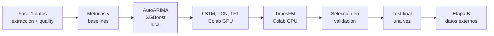

# Plan de implementación de los modelos

Este documento detalla cómo se construye y justifica cada uno de los seis modelos del
proyecto, qué hiperparámetros se exploran, qué fuentes de datos externas se incorporan y
cómo se relaciona cada parte con la estructura del informe final. El protocolo general
(datos, evaluación, prevención de fuga) está en el [README](../README.md).

El plan se apoya en tres principios:

1. **Igualdad de condiciones.** Todos los modelos usan los mismos datos, las mismas
   covariables y el mismo presupuesto de ajuste, para que las diferencias se deban al
   modelo y no a la preparación.
2. **Estacionalidad explícita.** El ciclo anual entra como términos de Fourier, no como
   una ventana de 365 días.
3. **Datos externos en una segunda etapa.** Así se puede medir cuánto aportan.

> **Ejecución actual.** El camino de ejecución es
> `scripts/run_model.py <runner> --against <runner>`: el runner solo ajusta, predice
> entre 1 y 14 días (por defecto 14) y exporta
> `data/predictions/<runner>/predictions.parquet`. `scripts/validate_predictions.py`
> recalcula las estadísticas desde esos archivos contra el segmento de validación. Las
> claves canónicas son `naive`, `seasonal_naive`, `arimax`, `booster`, `nsmt`,
> `transformer`, `timesfm3` y `tcn`; Nsmt es el LSTM. La separación A/B descrita abajo se
> conserva solo como referencia histórica del backtest legacy, no como etapa obligatoria
> de la ruta nueva.

---

## Decisiones tomadas

| Decisión | Elección | Justificación |
|---|---|---|
| Framework de redes | **PyTorch** (a través de Nixtla y TimesFM) | El material del curso sugiere TensorFlow/Keras, pero `neuralforecast` y TimesFM están construidos sobre PyTorch, y TensorFlow 2.11 en adelante no usa GPU en Windows nativo ([TF install](https://www.tensorflow.org/install/pip)). Los conceptos del curso (capas, funciones de activación, retropropagación, redes recurrentes) son los mismos en ambos frameworks. |
| Modelo final | **Uno solo para Ciudad Bolívar y Palúa** | Es la consigna: evaluar los seis modelos y elegir uno. |
| Datos de caudal modelado | **GloFAS** con cuenta de Copernicus EWDS | Es la covariable externa con más potencial (ver sección 3). |

---

## 1. Configuración común a todos los modelos

| Decisión | Valor | Justificación |
|---|---|---|
| Horizonte | `h = 14` | Lo exige el enunciado. |
| Targets | `ciudad_bolivar`, `palua` | Se modelan juntos como modelo global (un `unique_id` por estación), de modo que un solo modelo aprende de ambas series. |
| Estacionalidad anual | Términos de Fourier, período 365,25 días, K = 3 a 5 pares seno/coseno, como covariable futura | El ciclo anual se conoce de antemano, así que no hay fuga. Evita que ARIMA necesite `season_length=365`, que es inviable, y que las redes necesiten una ventana de un año para ver la estación. Es la recomendación de Hyndman para estacionalidades largas ([long seasonality](https://robjhyndman.com/hyndsight/longseasonality/)). Se generan con `utilsforecast.feature_engineering.fourier` ([referencia](https://nixtlaverse.nixtla.io/utilsforecast/feature_engineering)). |
| Estaciones aguas arriba | Ayacucho y Caicara; para Palúa también Ciudad Bolívar, como covariables **históricas** | Una crecida en Ayacucho llega días después a Ciudad Bolívar y desde allí a Palúa. Solo se usa su pasado. |
| Función de pérdida | MAE | Coincide con la métrica de selección; optimizar una métrica y elegir con otra es incoherente. |
| Escalado | `robust` (mediana y rango intercuartil) en las redes | Las crecidas son valores extremos legítimos que distorsionan un escalado por media y desviación estándar. |
| Ventanas de validación | Un corte antes de `test_start = 2023-01-01`, horizonte `1..14` (default 14) | La ruta de runners ejecuta un corte y valida el segmento siguiente; el backtest multi-ventana anterior fue retirado. |
| Longitud de entrada | `input_length=28` | Ventana compartida de `build_windows` para los modelos supervisados. |
| Semillas | 3 semillas por red neuronal; se reporta media ± desviación | Las redes varían con la inicialización; con una sola semilla una diferencia de pocos centímetros puede ser azar. |

### Longitud de la ventana de entrada

Según [Frappart et al. 2015](https://doi.org/10.3390/rs70100089), el almacenamiento de agua
en la llanura inundable **adelanta el caudal en Ciudad Bolívar en aproximadamente un mes**.
Por eso la ventana de entrada de las redes se busca entre **28, 56 y 112 días**: menos de un
mes pierde esa señal, y más de cuatro meses agrega costo sin información nueva, porque el
ciclo anual ya entra por Fourier. La correlación con rezago entre estaciones, calculada en
el análisis exploratorio, debe confirmar este rango con los propios datos.

---

## 2. Modelos

### 2.0 Baselines (referencia obligatoria)

| Modelo | Configuración | Justificación |
|---|---|---|
| `Naive` (persistencia) | Repite el último valor observado | Es el rival difícil de un río de cambio lento y la base del MASE. |
| `SeasonalNaive` | `season_length=365` | Representa "el río hace lo mismo que el año pasado". Aquí 365 no es problema porque el modelo no se ajusta, solo copia. |

### 2.1 Series temporales: AutoARIMA con regresores (ARIMAX)

| Parámetro | Valor | Justificación |
|---|---|---|
| `season_length` | **1** | La estacionalidad la aportan los términos de Fourier. Con 365 el ajuste es inviable y la diferenciación estacional a 365 días carece de sentido ([Hyndman](https://robjhyndman.com/hyndsight/longseasonality/)). |
| `max_p`, `max_q` | 5 (por defecto) | Rango estándar; el ACF/PACF del análisis exploratorio indicará si alcanza. |
| `max_d` | 2 | La diferenciación la decide la prueba KPSS (`test='kpss'`). |
| `ic` | `'aicc'` | Criterio de información corregido para muestras finitas; penaliza los modelos con más parámetros. |
| `stepwise` | `True` | Búsqueda de Hyndman–Khandakar en lugar de probar todas las combinaciones. |
| Regresores | Fourier + Ayacucho y Caicara **rezagadas al menos 14 días**; para Palúa también Ciudad Bolívar | ARIMAX necesita los valores de cada regresor durante los 14 días pronosticados; con rezago de 14 días o más ya están observados en el día del corte. |
| Ventana de entrenamiento | Últimos 10 a 15 años por corte | Reajustar ARIMA sobre 18 000 puntos en 24 ventanas es costoso, y la dinámica reciente es la más relevante. |

Referencia: [AutoARIMA en statsforecast](https://nixtlaverse.nixtla.io/statsforecast/src/core/models.html).

**Qué se espera:** ARIMA es lineal; capturará bien el ciclo anual y la inercia del río, pero
no la forma no lineal de las crecidas. Si aun así supera a las redes, es un resultado
defendible: en la competencia M4 los métodos estadísticos y sus combinaciones superaron a
los métodos de ML puros.

**Alternativa descartada:** MSTL con tendencia AutoARIMA
([tutorial](https://nixtlaverse.nixtla.io/statsforecast/docs/tutorials/multipleseasonalities.html)).
Es válida, pero separa la estacionalidad antes de modelar y se aleja del ARIMA pedido.

### 2.2 Ensamble de árboles: XGBoost con mlforecast

| Parámetro | Rango de búsqueda | Justificación |
|---|---|---|
| Estrategia multi-paso | **Directa**: `fit(max_horizon=14)` | Entrena un modelo por día del horizonte. La estrategia recursiva realimenta sus propias predicciones y acumula error ([Ben Taieb et al. 2012](https://research.monash.edu/en/publications/a-review-and-comparison-of-strategies-for-multi-step-ahead-time-s/), [mlforecast](https://nixtlaverse.nixtla.io/mlforecast/docs/how-to-guides/one_model_per_horizon.html)). |
| `lags` | `[1, 2, 3, 7, 14, 21, 28, 56]` | Inercia diaria, ciclo semanal y retrasos de 2 a 8 semanas de la llanura inundable. |
| `lag_transforms` | `RollingMean` de 7 y 30 días | Suaviza el ruido diario y aporta la tendencia del último mes. |
| `target_transforms` | `Differences([1])` | Los árboles no extrapolan fuera del rango visto en entrenamiento; modelar el cambio diario permite predecir crecidas récord. |
| `n_estimators` | 300 a 1500 | Se combina con la tasa de aprendizaje: menor tasa, más árboles. |
| `learning_rate` | 0,01 a 0,1 | El valor por defecto (0,3) es agresivo para series ruidosas. |
| `max_depth` | 3 a 8 | Controla la complejidad de las interacciones (por defecto 6). |
| `subsample`, `colsample_bytree` | 0,6 a 1,0 | El submuestreo de filas y columnas reduce el sobreajuste. |
| `min_child_weight`, `reg_lambda` | 1 a 10 | Regularización: exige más datos para crear una rama. |
| Covariables | Ayacucho y Caicara pre-rezagadas ≥ 14 días, con `static_features=[]` | Sin indicarlo, mlforecast trata toda columna extra como estática ([exógenas](https://nixtlaverse.nixtla.io/mlforecast/docs/how-to-guides/exogenous_features.html)). |

Referencia: [parámetros de XGBoost](https://xgboost.readthedocs.io/en/stable/parameter.html).

**Justificación del modelo:** la competencia M5 la ganó una combinación de modelos LightGBM
directos y recursivos ([M5](https://ideas.repec.org/a/eee/intfor/v38y2022i4p1346-1364.html)).
Es el competidor tabular más fuerte y el más barato de entrenar.

### 2.3 Red recurrente: LSTM

| Parámetro | Valor o rango | Justificación |
|---|---|---|
| `input_size` | 28 / 56 / 112 | Ver "Longitud de la ventana de entrada". |
| `encoder_hidden_size` | 64 / 128 | Tamaño de la memoria interna; con 18 000 datos, más de 128 tiende a sobreajustar. |
| `encoder_n_layers` | 1 / 2 | Dos capas permiten patrones jerárquicos (diario y mensual); más capas rara vez ayudan en series univariadas. |
| `encoder_dropout` | 0,1 a 0,3 | Regularización. |
| `recurrent` | `False` | Predice los 14 días de una vez (salida múltiple, MIMO) en lugar de realimentarse paso a paso, lo que evita acumular error. |
| `learning_rate` | 1e-4 a 1e-3 | El valor por defecto es 1e-3. |
| `max_steps` | 1000 a 3000 | Combinado con parada temprana. |
| `early_stop_patience_steps` | 5, con `val_check_steps=100` y `val_size=365` | Detiene el entrenamiento cuando el error en el último año del bloque de entrenamiento deja de bajar. |
| `hist_exog_list` | Ayacucho, Caicara | Solo se usa su pasado. |
| `futr_exog_list` | Términos de Fourier | Se conocen de antemano. |

Referencia: [LSTM en neuralforecast](https://nixtlaverse.nixtla.io/neuralforecast/models.lstm.html).

**Relación con el curso:** es la red recurrente con memoria explícita; sus compuertas usan
las funciones sigmoide y tanh. **Antecedente:** [Kratzert et al. 2018](https://hess.copernicus.org/articles/22/6005/2018/)
muestra que el LSTM es competitivo en modelación lluvia–escorrentía.

### 2.4 Red convolucional: TCN

| Parámetro | Valor o rango | Justificación |
|---|---|---|
| `kernel_size` | 2 / 3 | Días consecutivos que mira cada filtro. |
| `dilations` | `[1, 2, 4, 8, 16]` (por defecto) o `[1, 2, 4, 8, 16, 32]` | Las dilataciones hacen que los filtros salten días, de modo que la red ve lejos con pocas capas. |
| `encoder_hidden_size` | 64 / 128 | Número de filtros por capa. |
| `input_size` | Igual o mayor que el campo receptivo | Si la ventana es más corta que lo que la red puede mirar, parte de la red no recibe datos. |
| Exógenas | Igual que el LSTM | La TCN admite covariables históricas y futuras. |

Referencia: [TCN en neuralforecast](https://nixtlaverse.nixtla.io/neuralforecast/models.tcn.html).

**Campo receptivo:** `1 + (kernel_size − 1) × suma(dilations)`. Con kernel 2 y las
dilataciones por defecto son 32 días; con kernel 3, 63 días. Esto vincula el diseño de la
red con el retraso físico del río.

**Justificación del modelo:** las convoluciones son causales (cada salida depende solo del
pasado), por lo que la arquitectura no puede usar información futura, y se entrena en
paralelo, mucho más rápido que un LSTM. Usa activación ReLU.

### 2.5 Transformer: TFT (Temporal Fusion Transformer)

> **Cambio posterior:** se implementó un Transformer propio en lugar del TFT, para compararlo con
> el CNN-LSTM con el mismo pipeline. Ver [`modelos_transformer_timesfm.md`](modelos_transformer_timesfm.md).

| Parámetro | Valor o rango | Justificación |
|---|---|---|
| `hidden_size` | 32 / 64 / 128 | El valor por defecto (128) es grande para 18 000 datos. |
| `n_head` | 4 | Cada cabeza de atención aprende a fijarse en un patrón temporal distinto. |
| `dropout`, `attn_dropout` | 0,1 a 0,3 | Es el modelo de los seis con más tendencia a sobreajustar. |
| `input_size` | 56 / 112 | La atención se beneficia de ventanas largas. |
| Exógenas | Históricas, futuras y estáticas | Es el Transformer de `neuralforecast` que admite los tres tipos ([capacidades](https://nixtlaverse.nixtla.io/neuralforecast/docs/capabilities/overview.html)). |

Referencia: [TFT en neuralforecast](https://nixtlaverse.nixtla.io/neuralforecast/models.tft.html).

**Valor para el informe:** su selección de variables y sus pesos de atención se pueden
graficar, mostrando cuánto pesó cada estación y qué días del pasado miró el modelo.

**Hipótesis:** [Zeng et al. 2023](https://ojs.aaai.org/index.php/AAAI/article/view/26317)
muestran que los Transformers a menudo no superan a modelos lineales en series temporales.
Si el TFT pierde frente a ARIMAX, el informe lo explica con esa referencia.

### 2.6 Modelo de Google: TimesFM 3.0 (*zero-shot*)

| Parámetro | Valor | Justificación |
|---|---|---|
| Checkpoint | `google/timesfm-3.0-pytorch` | Unos 330 millones de parámetros; pesos con licencia no comercial, compatible con un proyecto académico. |
| Contexto | 512 / 1024 / 2048 días | Admite hasta 15 360 puntos; más contexto muestra varios ciclos anuales. |
| `horizon` | 14 | |
| `past_only_covariates` | Ayacucho, Caicara | Solo pasado. |
| `past_future_covariates` | Términos de Fourier | Se conocen de antemano. |
| `return_quantiles` | `True` | Intervalos de incertidumbre (deciles 0,1 a 0,9) sin costo extra. |

Referencia: [README de TimesFM](https://github.com/google-research/timesfm)
(`TimesFM3Evaluator.predict_batch`).

**Justificación del modelo:** es el único que no se entrena con datos del Orinoco
([Das et al. 2024](https://proceedings.mlr.press/v235/das24c.html)). Responde si un modelo
preentrenado con miles de series supera a uno entrenado para este río.

**Pendiente de verificar:** la API instalada (el README de la versión 3.0 es inconsistente
en los nombres de las clases; comprobar con `dir(timesfm3)` en Colab) y si corre en CPU (no
está documentado; planificar en Colab con GPU). El ajuste fino con LoRA queda para
trabajos futuros, porque entrenarlo rompe la comparación *zero-shot*.

---

## 3. Fuentes de datos externas

| Prioridad | Fuente | Qué aporta | Cobertura | Acceso | Riesgo |
|---|---|---|---|---|---|
| 1 | [NASA POWER](https://power.larc.nasa.gov/docs/services/api/temporal/daily/) `PRECTOTCORR` | Lluvia diaria en puntos de la cuenca | 1981 → presente | API REST | Reanálisis MERRA-2 de resolución gruesa (~0,5°). |
| 2 | [CHIRPS v2](https://www.chc.ucsb.edu/data/chirps) | Lluvia diaria de mayor resolución (0,05°) | 1981 → presente | HTTPS o Google Earth Engine; dominio público | Requiere promediar sobre la cuenca. La v2 deja de producirse en diciembre de 2026; migrar a [v3](https://www.chc.ucsb.edu/data/chirps3). |
| 3 | [GloFAS historical](https://ewds.climate.copernicus.eu/datasets/cems-glofas-historical) | Caudal modelado diario en puntos de los afluentes (Apure, Meta, Caura) | 1979 → presente | Copernicus EWDS con cuenta | Es caudal simulado, no medido, pero resume la lluvia de toda la cuenca en un solo número. |
| 4 | [NOAA PSL](https://psl.noaa.gov/data/climateindices/list/): ONI, TNA, SOI | Fase de El Niño / La Niña y temperatura del Atlántico tropical norte | 1950 → presente, mensual | Archivo de texto abierto | Debe rezagarse según el retraso de publicación más los 14 días del horizonte. |
| Trabajo futuro | [ERA5-Land](https://cds.climate.copernicus.eu/datasets/reanalysis-era5-land?tab=overview) | Humedad del suelo, escorrentía | 1950 → presente | Copernicus CDS con cuenta | Volumen de datos grande para el alcance del proyecto. |
| No disponible | Descargas de la represa de Guri / caudal del Caroní | — | — | No se encontró fuente pública | Afecta principalmente a Palúa, por su cercanía a la confluencia. |

**Ubicación de los puntos de lluvia:** según
[Builes-Jaramillo et al. 2024](https://www.revistascca.unam.mx/atm/index.php/atm/article/view/53359),
los sectores andino y guayanés aportan cada uno cerca de la mitad de la escorrentía, por lo
que conviene muestrear ambos: Llanos y Meta por un lado, Caura y Ventuari por el otro.

### Configuración de GloFAS

1. Iniciar sesión en [EWDS](https://ewds.climate.copernicus.eu/how-to-api) y copiar la
   configuración que se muestra allí al archivo `.cdsapirc` de la carpeta de usuario. Debe
   contener la URL `https://ewds.climate.copernicus.eu/api` y el token personal.
2. Aceptar los términos de la licencia en la página del dataset; sin ese paso las descargas
   fallan.
3. Usar el cliente `cdsapi>=0.7.4`.
4. Copiar el pedido exacto que genera el formulario de descarga del dataset: los parámetros
   cambian entre versiones, y la versión operacional es v5.0 (publicada el 2026-07-15).

El token es una credencial personal: nunca se escribe en el repositorio ni en una celda de
notebook. En Colab se usa la sección *Secrets* del panel lateral.

### Diseño en dos etapas (histórico)

1. **Etapa A, solo el río (1974–2025).** Los seis modelos y los baselines con covariables
   de estaciones y Fourier. Es la comparación principal y la base de la selección.
2. **Etapa B, con datos externos (1981–2025).** Se agregan lluvia, GloFAS e índices
   climáticos. Los modelos sin datos externos se reevalúan sobre el mismo período 1981+
   para que la comparación sea justa; la diferencia mide cuánto aportan las fuentes.

La ruta de runners ya no expone `--stage`: ejecuta siempre con lluvia y ONI. El diseño A/B
queda como referencia del backtest anterior y de los resultados ya guardados.

Si el tiempo no alcanza, la etapa B se ejecuta solo con los dos o tres mejores modelos de la
etapa A, y el informe lo declara.

---

## 4. Orden de implementación

---

## 5. Relación con el informe final

| Sección del informe | Contenido |
|---|---|
| Introducción | Importancia de pronosticar el nivel del Orinoco a 14 días (navegación, puertos de Ciudad Guayana, alertas) y objetivo: seleccionar el mejor de seis modelos. |
| Antecedentes del problema | [Dibike & Solomatine 2001](https://experts.mcmaster.ca/scholarly-works/1645094): redes neuronales en la cuenca del Apure. [Frappart et al. 2015](https://doi.org/10.3390/rs70100089): la llanura inundable adelanta el caudal un mes. [Gualtieri et al. 2022](https://iahr.org/library/info?pid=20764): régimen unimodal con pico en agosto. [Kratzert et al. 2018](https://hess.copernicus.org/articles/22/6005/2018/) y [Nearing et al. 2024](https://www.ncbi.nlm.nih.gov/pmc/articles/PMC10954541/): LSTM en hidrología. No se encontraron estudios publicados de ML sobre el cauce principal del Orinoco. |
| Descripción del problema | Datos, mapa de estaciones, calidad de datos, protocolo de evaluación y prevención de fuga (README). |
| Justificación de cada modelo | Sección 2 de este documento: qué hace cada modelo, por qué se eligió, sus hiperparámetros y qué se espera. |
| Comparación de resultados | Tabla de métricas por modelo y estación, error según el día del horizonte, pronósticos frente a lo observado. |
| Análisis de los resultados | Quién supera a la persistencia y desde qué día, desempeño en crecidas, atención del TFT, aporte de los datos externos (etapa B). |
| Conclusiones | Modelo elegido, su error en el test final y limitaciones (datos de base ya imputados, ausencia de datos de Guri). |
| Trabajos futuros | Ajuste fino de TimesFM con LoRA, ERA5-Land, datos de Guri, ensamble de modelos, pronósticos de lluvia como covariable futura. |
